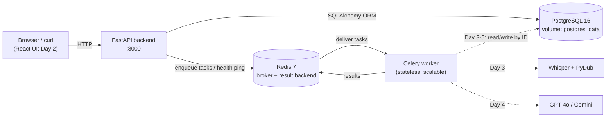
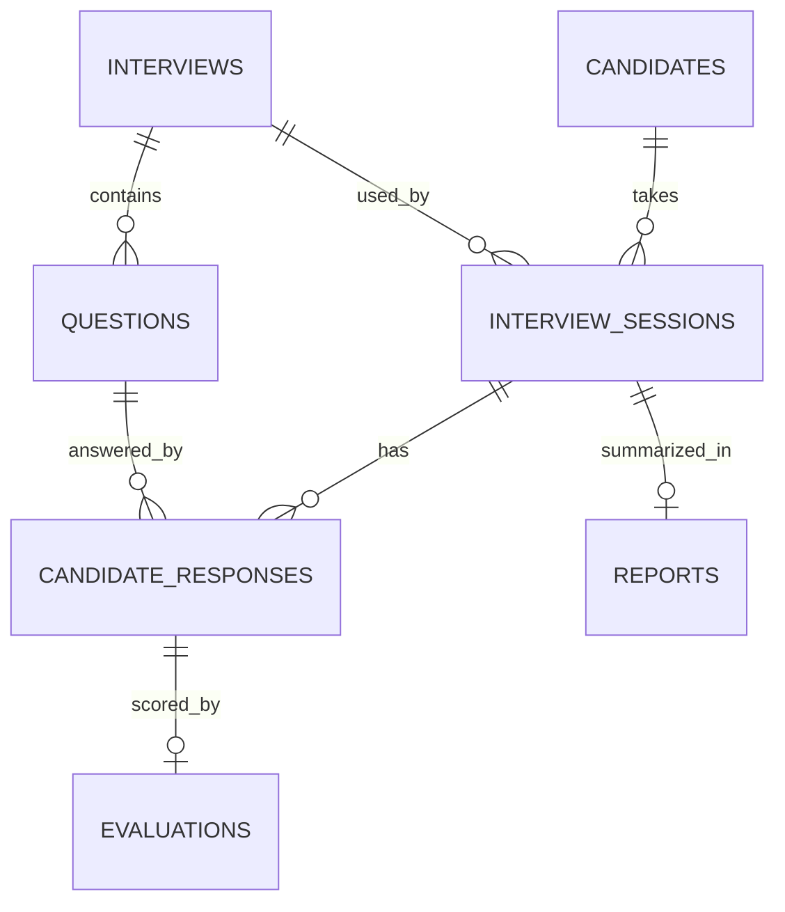
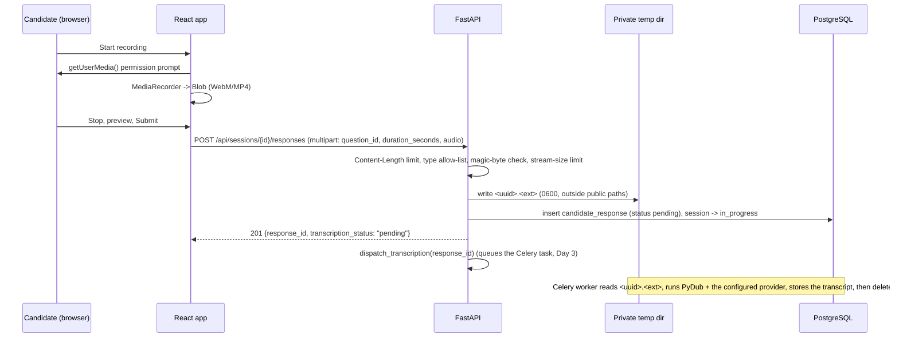
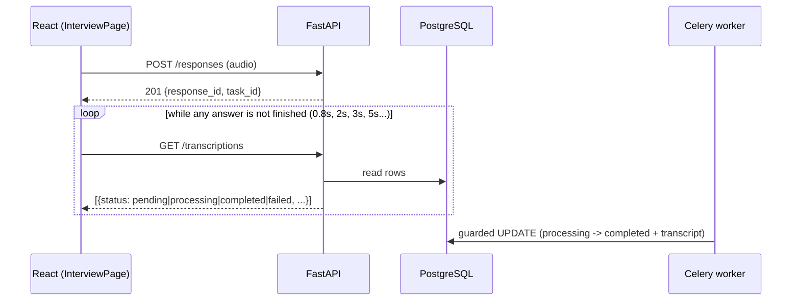

# HireIQ Architecture (Day 1)

Only components that exist today are shown as solid. Later-day components are dashed.



## Components
- **FastAPI backend** (`backend/app`): app factory, settings from environment, CORS, JSON error handling, Swagger UI. Endpoints: `/`, `/health` (liveness), `/health/db`, `/health/redis` (real connection attempts; HTTP 503 when unreachable).
- **PostgreSQL + SQLAlchemy 2**: UUID primary keys, timestamps, indexes, uniqueness and score CHECK constraints. Schema is created by Alembic (`0001_initial_schema`), not by `create_all`.
- **Redis**: Celery broker and short-lived result backend (results expire after 1 hour).
- **Celery worker**: JSON-only serialization, `acks_late`, prefetch 1, time limits, retry/backoff on the demo task. Workers hold no shared in-memory state: tasks will receive IDs and use PostgreSQL, so workers can be scaled with `docker compose up --scale worker=N`.
- **Service communication**: inside Docker, services find each other by name (`postgres`, `redis`). Only the backend port 8000 is published; PostgreSQL and Redis are not exposed to the host.

## Data model

Deletion rules: deleting a candidate removes their sessions, responses, evaluations and reports (data-erasure friendly). An interview or question that is already used cannot be deleted (`RESTRICT`).

## Privacy decisions already built in
- Candidate table stores only name, email and consent time.
- No audio path column: audio is never kept (deleted after transcription, Day 3).
- Evaluation rows require validated data (NOT NULL); the Pydantic gate is built on Day 4.
- Logs contain error class names and paths, never request bodies or transcripts.


---

# Day 2 additions: candidate UI and audio submission

## Frontend structure (`frontend/src`)
| Folder | Contents |
|---|---|
| `pages/` | `WelcomePage` (instructions, details, consent), `InterviewPage` (questions, timer, recorder, submit, navigation), `CompletePage` |
| `components/` | `BrandHeader`, `Alert`, `ProgressBar`, `QuestionCard`, `RecorderPanel`, `DemoBanner` |
| `hooks/` | `useAudioRecorder` (MediaRecorder state machine), `useElapsedSeconds` |
| `services/` | `api.ts` (fetch + XMLHttpRequest upload with progress/timeout), `config.ts` (env), `demoApi.ts` (sample data, demo mode only) |
| `types/` | TypeScript mirrors of the backend schemas |

The recorder is a small state machine: `idle → requesting → recording ⇄ paused → stopping → stopped`, with `error` reachable from any step. Error kinds: `unsupported`, `insecure-context`, `permission-denied`, `no-microphone`, `microphone-busy`, `interrupted`, `empty`, `unknown`.

## Audio submission flow


## Session lifecycle
`created` → (first upload) `in_progress` → (`POST .../complete`, all questions answered) `submitted`. Submitted sessions reject further uploads (409). Day 3+ will move them on to `processing` / `evaluated` / `failed`.

## Day 2 -> Day 3 integration points (implemented in Day 3)
- `services/transcription_dispatch.dispatch_transcription(response_id)`: queues the Celery task `hireiq.transcribe_response` once per answer.
- `services/audio_intake.find_audio_path(response_id, dir)` and `delete_audio(...)`: used by the worker. Backend and worker already share the `audio_tmp` volume in `docker-compose.yml`.

## Security notes
- Candidate view of a question (`QuestionPublic`) excludes rubric data.
- The session UUID is a bearer capability; there is no further auth yet.
- Errors never echo file contents or server paths; unhandled errors return a generic 500.


---

# Day 3 additions: audio processing and asynchronous transcription

## Components
| Module | Role |
|---|---|
| `services/audio_intake.py` | (Day 2) validates and stores the upload; Day 3 adds per-attempt scratch folders and purges stale scratch folders |
| `services/audio_processing.py` | PyDub pipeline: validate source -> bounded decode -> duration checks -> mono / 16 kHz / 16-bit -> silence check -> peak-normalize -> `prepared.wav` |
| `services/transcription/` | `TranscriptionProvider` interface; `mock`, `openai` (HTTP API via `requests`), `local` (open-source Whisper) providers; `factory.py` |
| `services/transcription_dispatch.py` | Queues the Celery task once per answer (DB-guarded), never raises |
| `services/transcription_service.py` | One attempt: claim -> process -> guarded result write -> delete audio |
| `workers/transcription_tasks.py` | Celery task `hireiq.transcribe_response`: retry with back-off, failure recording |
| `services/transcription_status.py` + routes | Status views, list, manual retry |

## Pipeline
```mermaid
flowchart TD
    U[Upload accepted] --> D{dispatch_transcription}
    D -- "claim celery_task_id (once)" --> Q[(Redis queue)]
    D -- broker down --> P0[row stays pending, task_id null; retry endpoint recovers]
    Q --> W[Celery worker]
    W --> C{claim: task id matches and status pending/processing?}
    C -- no --> S1[skip: duplicate / finished]
    C -- yes --> A[PyDub: decode (bounded), mono 16 kHz, normalize]
    A -- bad file --> F1[failed + delete audio]
    A -- silent --> N[completed, no_speech, provider skipped]
    A --> T[provider.transcribe]
    T -- temporary error --> R[Celery retry with back-off] --> W
    T -- retries exhausted / permanent --> F2[failed, audio kept for recovery]
    T --> O{still owner?}
    O -- yes --> OK[commit transcript, THEN delete raw audio]
    O -- no --> S2[discard result, keep audio]
```

## Task status state machine
`pending` (queued) -> `processing` (claimed; attempts+1 on every claim) -> `completed` | `failed`.
`failed` / never-queued / stuck-`processing` answers can be put back to `pending` with a new task id by the retry endpoint (only while audio exists and attempts < `TRANSCRIPTION_MAX_ATTEMPTS`).

## Sequence: status polling


## Data model additions
`candidate_responses` gained `transcript_language`, `transcription_provider`, `transcription_attempts`, `transcription_started_at`, `transcription_completed_at`, `no_speech_detected` (migration `0002`). Existing columns reused: `transcript`, `transcript_segments` (JSON, timestamps), `audio_duration_seconds` (now the server-measured value), `transcription_status`, `transcription_error` (a code only), `celery_task_id`.

## Security and privacy decisions
- API keys only in server settings (`SecretStr`), sent in an HTTP header, never logged or placed in error messages; `mock` is refused in production; `openai` without a key refuses to start.
- Redis carries only a response id; Celery results contain a status and an error code, never text.
- Raw audio: private directory (0700/0600), server-generated names, deleted after commit, retention rules in the README. Scratch folders are unique per attempt so concurrent workers cannot touch each other's files.
- Decoding is bounded (`ffmpeg -t max+1`) so a small compressed file cannot expand into gigabytes of PCM.
