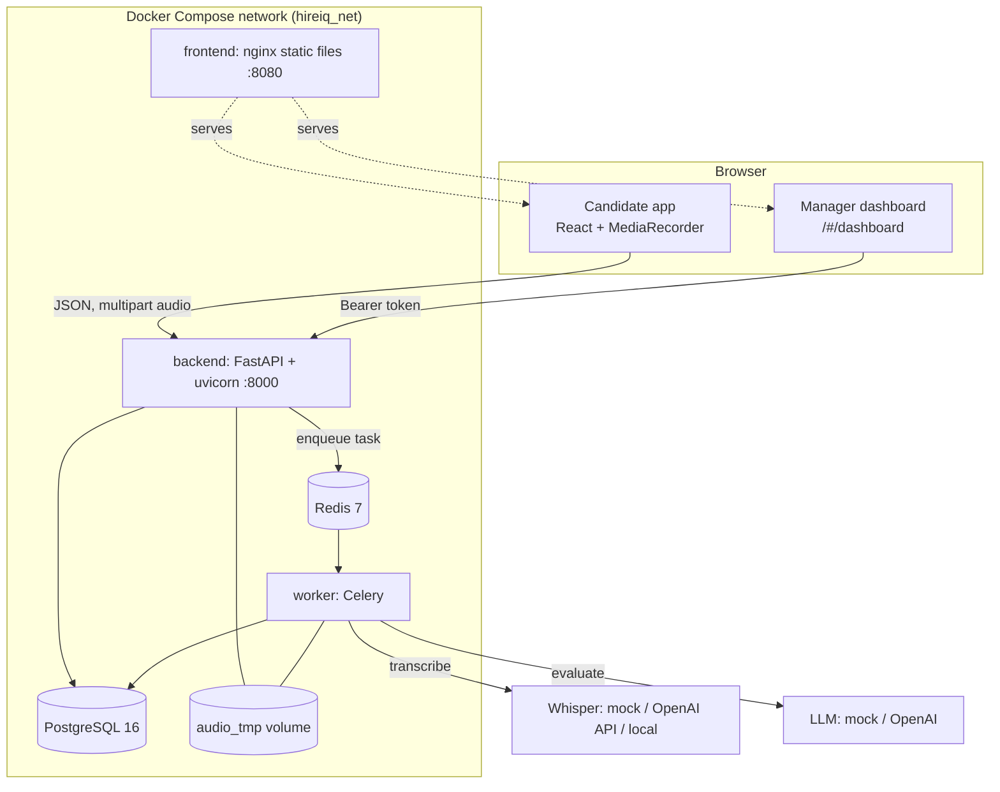
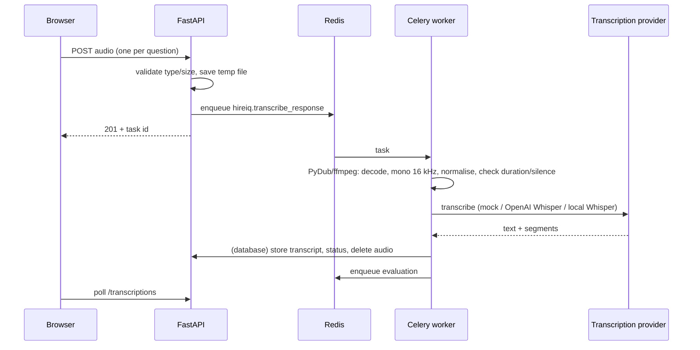
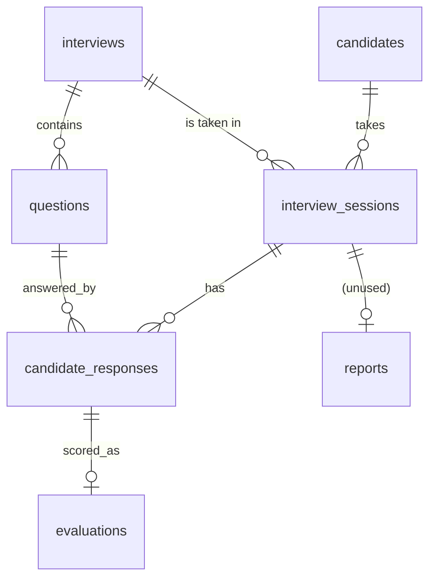
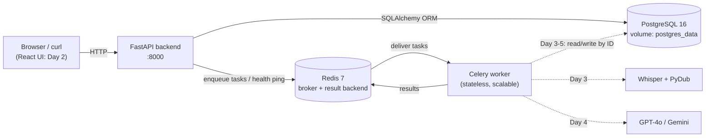
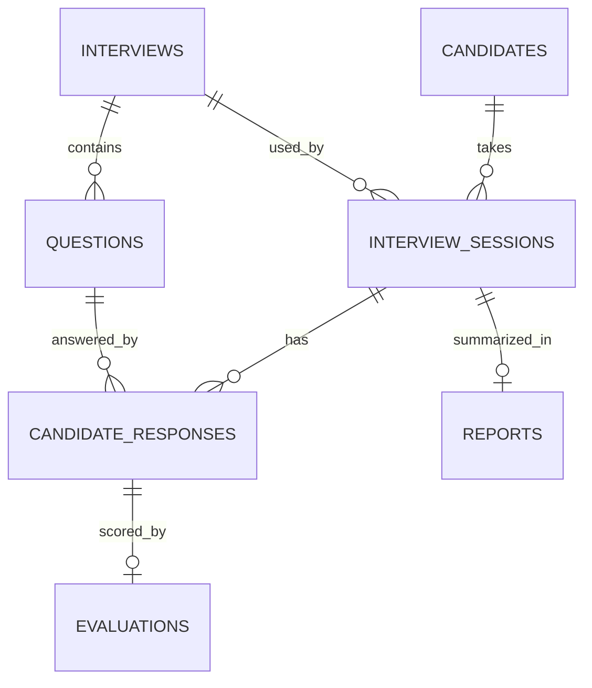
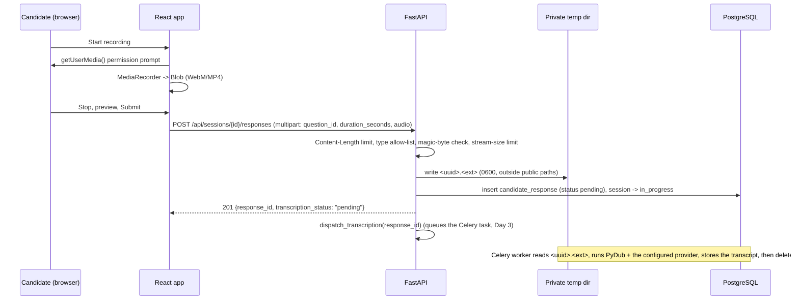
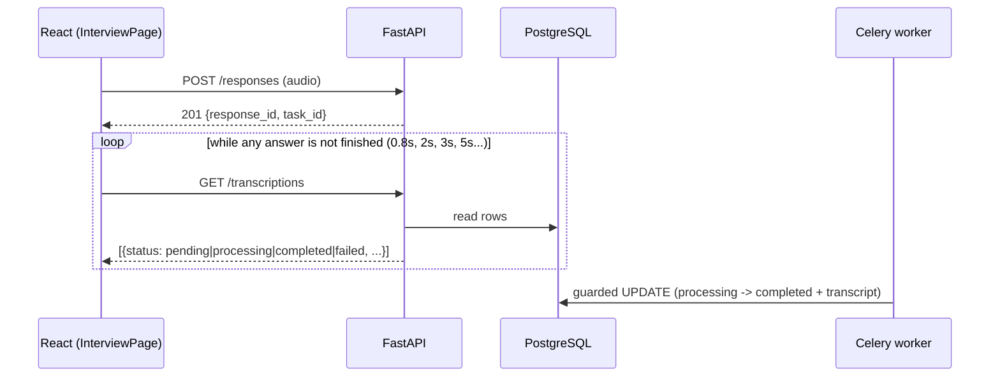
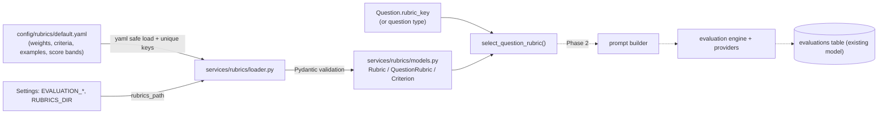
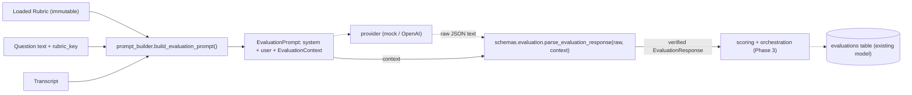

# HireIQ architecture — final overview (Day 10)

This overview consolidates the design after Day 10. The per-day sections that follow (Day 1–8) keep the original, more detailed notes. Statements about behaviour describe the code; most runtime paths were never executed against real services (see `docs/FINAL_PROJECT_REPORT.md`).

## System diagram


## Frontend (`frontend/src`)
React 18 + TypeScript + Vite single-page app, hash routing in `Root.tsx`: `/` = candidate app (`App.tsx`: welcome → interview → complete), `/#/dashboard` = manager dashboard (`pages/DashboardPage.tsx`). Components are presentational; state lives in pages and hooks (`useAudioRecorder`, `useElapsedSeconds`, `useTranscriptions` polling). All HTTP goes through `services/api.ts` (candidate) and `services/dashboardApi.ts` (manager, takes the token in memory only). The API base URL is `VITE_API_BASE_URL`, fixed at build time. Production build = `tsc` + `vite build`, served by nginx (`frontend/Dockerfile`, `nginx.conf`). The browser only ever holds a candidate's own session id (sessionStorage) and, for managers, the token in a React state variable.

## Backend (`backend/app`)
Layered: `api/routes` (HTTP, auth dependency, status codes) → `services` (business rules) → `models` (SQLAlchemy 2) with `schemas` (Pydantic v2) at the edges and `core` (settings, database, logging). Routers: `interviews`, `sessions` (public candidate API); `reports`, `dashboard`, `question_bank` (bearer-token protected); `health`, `root`. `main.py` adds CORS from settings, an upload-size middleware, a constant 500 handler, and purges stale audio at start-up.

## API communication
| Caller | Routes | Protection |
|---|---|---|
| Candidate browser | `GET /api/interviews`, `POST /api/sessions`, `GET /api/sessions/{id}`, `POST .../responses` (audio), `POST .../complete`, `GET .../transcriptions`, transcription retry | none; the session UUID is the capability; no scores/rubric returned |
| Manager browser | `GET /api/dashboard/{summary,sessions,sessions/{id}}`, `GET /api/reports/{id}/pdf`, `/api/question-bank/*` | `Authorization: Bearer <REPORT_ACCESS_TOKEN>` (shared secret; 401 wrong, 503 unset) |
| Monitoring | `GET /health`, `/health/db`, `/health/redis` | none |
Errors use JSON `{"detail": ...}`; validation errors are the framework default (422).

## Whisper transcription pipeline

Retries are automatic for temporary errors (rate limit, timeout) up to a limit, plus a manual retry endpoint; a crashed task is detected by a "stuck" timeout; silence is reported as "no speech", never as a score.

## AI evaluation pipeline
`hireiq.evaluate_response` (Celery) → `engine.py` claims the answer, loads the interview's YAML rubric (`rubric_name`, `rubric_key`), builds the prompt (`prompt_builder.py`: fixed system rules, rubric, question and transcript as delimited data), calls the provider (`mock` or `openai`), parses the JSON strictly (`schemas/evaluation.py`: no extra fields, scores in range, evidence must appear in the transcript), computes the **weighted score from the YAML weights itself** (`scoring.py`; the model's own overall score is ignored), stores one `evaluations` row, then runs NLP enrichment and finally updates session status (`coordination.py`). Failure codes (`rubric_missing`, `invalid_json`, `evidence_invalid`, `provider_timeout`, …) are stored; temporary ones are retried with back-off.

## NLP enrichment (advisory)
After a successful evaluation `services/nlp` adds keywords and entities (spaCy `en_core_web_sm`), sentiment (VADER) and a rule-based confidence indicator into `evaluations.nlp_enrichment`. It never writes the score or the recommendation, is not imported by the scoring code, and a failure of any part leaves the evaluation intact (`partial` status).

## Database structure (migrations 0001–0004)

`candidates` (name, e-mail, consent time) · `interviews` (title, type, `rubric_name`, active flag, time limit) · `questions` (position, text, type, `rubric_key`, time limit, and since 0004 optional `category`, `difficulty`, `expected_skills`) · `interview_sessions` (status, start/complete times) · `candidate_responses` (transcript, transcription and evaluation status/attempts/errors, task ids, no-speech flag; audio is **not** stored long-term) · `evaluations` (overall score, per-criterion scores with evidence, explanation, recommendation, `nlp_enrichment`, provider/model/rubric/prompt-version details) · `reports` (created on Day 1, **never used**: PDFs are generated on demand).

## Background processing
Celery with Redis as broker and result backend; the default Celery queue; the worker runs `hireiq.transcribe_response` and `hireiq.evaluate_response` (concurrency 2). Tasks are idempotent-by-claim (a status update guards against duplicate work) and the API stays responsive because it only enqueues.

## PDF generation
`GET /api/reports/{id}/pdf` → token check → read-only loader → sanitised frozen data → ReportLab renders (cover, scores, radar chart drawn from stored criterion scores, evidence, NLP context, advisory notice). No re-scoring, no LLM call, no stored file.

## Dashboard workflow
Manager opens `/#/dashboard` → enters token (kept in memory) → `summary` + `sessions` requests (filters: search, interview, status, recommendation, page) → opens a session (`sessions/{id}`: scores, evidence, advisory NLP, no transcript/e-mail/audio paths) → optional PDF download through the report endpoint. A 401/503 signs the manager out.

## Deployment topology
Five Compose services (section above). The frontend container serves static files only; it never proxies the API, so the browser calls the API address given by `VITE_API_BASE_URL` and the API must list the frontend origin in `CORS_ORIGINS`. Nothing has been deployed: see `docs/DEPLOYMENT_GUIDE.md`.

---

# Original per-day architecture notes

### HireIQ Architecture (Day 1)

Only components that exist today are shown as solid. Later-day components are dashed.



## Components
- **FastAPI backend** (`backend/app`): app factory, settings from environment, CORS, JSON error handling, Swagger UI. Endpoints: `/`, `/health` (liveness), `/health/db`, `/health/redis` (real connection attempts; HTTP 503 when unreachable).
- **PostgreSQL + SQLAlchemy 2**: UUID primary keys, timestamps, indexes, uniqueness and score CHECK constraints. Schema is created by Alembic (`0001_initial_schema`), not by `create_all`.
- **Redis**: Celery broker and short-lived result backend (results expire after 1 hour).
- **Celery worker**: JSON-only serialization, `acks_late`, prefetch 1, time limits, retry/backoff on the demo task. Workers hold no shared in-memory state: tasks will receive IDs and use PostgreSQL, so workers can be scaled with `docker compose up --scale worker=N`.
- **Service communication**: inside Docker, services find each other by name (`postgres`, `redis`). Only the backend port 8000 is published; PostgreSQL and Redis are not exposed to the host.

## Data model

Deletion rules: deleting a candidate removes their sessions, responses, evaluations and reports (data-erasure friendly). An interview or question that is already used cannot be deleted (`RESTRICT`).

## Privacy decisions already built in
- Candidate table stores only name, email and consent time.
- No audio path column: audio is never kept (deleted after transcription, Day 3).
- Evaluation rows require validated data (NOT NULL); the Pydantic gate is built on Day 4.
- Logs contain error class names and paths, never request bodies or transcripts.


---

# Day 2 additions: candidate UI and audio submission

## Frontend structure (`frontend/src`)
| Folder | Contents |
|---|---|
| `pages/` | `WelcomePage` (instructions, details, consent), `InterviewPage` (questions, timer, recorder, submit, navigation), `CompletePage` |
| `components/` | `BrandHeader`, `Alert`, `ProgressBar`, `QuestionCard`, `RecorderPanel`, `DemoBanner` |
| `hooks/` | `useAudioRecorder` (MediaRecorder state machine), `useElapsedSeconds` |
| `services/` | `api.ts` (fetch + XMLHttpRequest upload with progress/timeout), `config.ts` (env), `demoApi.ts` (sample data, demo mode only) |
| `types/` | TypeScript mirrors of the backend schemas |

The recorder is a small state machine: `idle → requesting → recording ⇄ paused → stopping → stopped`, with `error` reachable from any step. Error kinds: `unsupported`, `insecure-context`, `permission-denied`, `no-microphone`, `microphone-busy`, `interrupted`, `empty`, `unknown`.

## Audio submission flow


## Session lifecycle
`created` → (first upload) `in_progress` → (`POST .../complete`, all questions answered) `submitted`. Submitted sessions reject further uploads (409). Day 3+ will move them on to `processing` / `evaluated` / `failed`.

## Day 2 -> Day 3 integration points (implemented in Day 3)
- `services/transcription_dispatch.dispatch_transcription(response_id)`: queues the Celery task `hireiq.transcribe_response` once per answer.
- `services/audio_intake.find_audio_path(response_id, dir)` and `delete_audio(...)`: used by the worker. Backend and worker already share the `audio_tmp` volume in `docker-compose.yml`.

## Security notes
- Candidate view of a question (`QuestionPublic`) excludes rubric data.
- The session UUID is a bearer capability; there is no further auth yet.
- Errors never echo file contents or server paths; unhandled errors return a generic 500.


---

# Day 3 additions: audio processing and asynchronous transcription

## Components
| Module | Role |
|---|---|
| `services/audio_intake.py` | (Day 2) validates and stores the upload; Day 3 adds per-attempt scratch folders and purges stale scratch folders |
| `services/audio_processing.py` | PyDub pipeline: validate source -> bounded decode -> duration checks -> mono / 16 kHz / 16-bit -> silence check -> peak-normalize -> `prepared.wav` |
| `services/transcription/` | `TranscriptionProvider` interface; `mock`, `openai` (HTTP API via `requests`), `local` (open-source Whisper) providers; `factory.py` |
| `services/transcription_dispatch.py` | Queues the Celery task once per answer (DB-guarded), never raises |
| `services/transcription_service.py` | One attempt: claim -> process -> guarded result write -> delete audio |
| `workers/transcription_tasks.py` | Celery task `hireiq.transcribe_response`: retry with back-off, failure recording |
| `services/transcription_status.py` + routes | Status views, list, manual retry |

## Pipeline
```mermaid
flowchart TD
    U[Upload accepted] --> D{dispatch_transcription}
    D -- "claim celery_task_id (once)" --> Q[(Redis queue)]
    D -- broker down --> P0[row stays pending, task_id null; retry endpoint recovers]
    Q --> W[Celery worker]
    W --> C{claim: task id matches and status pending/processing?}
    C -- no --> S1[skip: duplicate / finished]
    C -- yes --> A[PyDub: decode (bounded), mono 16 kHz, normalize]
    A -- bad file --> F1[failed + delete audio]
    A -- silent --> N[completed, no_speech, provider skipped]
    A --> T[provider.transcribe]
    T -- temporary error --> R[Celery retry with back-off] --> W
    T -- retries exhausted / permanent --> F2[failed, audio kept for recovery]
    T --> O{still owner?}
    O -- yes --> OK[commit transcript, THEN delete raw audio]
    O -- no --> S2[discard result, keep audio]
```

## Task status state machine
`pending` (queued) -> `processing` (claimed; attempts+1 on every claim) -> `completed` | `failed`.
`failed` / never-queued / stuck-`processing` answers can be put back to `pending` with a new task id by the retry endpoint (only while audio exists and attempts < `TRANSCRIPTION_MAX_ATTEMPTS`).

## Sequence: status polling


## Data model additions
`candidate_responses` gained `transcript_language`, `transcription_provider`, `transcription_attempts`, `transcription_started_at`, `transcription_completed_at`, `no_speech_detected` (migration `0002`). Existing columns reused: `transcript`, `transcript_segments` (JSON, timestamps), `audio_duration_seconds` (now the server-measured value), `transcription_status`, `transcription_error` (a code only), `celery_task_id`.

## Security and privacy decisions
- API keys only in server settings (`SecretStr`), sent in an HTTP header, never logged or placed in error messages; `mock` is refused in production; `openai` without a key refuses to start.
- Redis carries only a response id; Celery results contain a status and an error code, never text.
- Raw audio: private directory (0700/0600), server-generated names, deleted after commit, retention rules in the README. Scratch folders are unique per attempt so concurrent workers cannot touch each other's files.
- Decoding is bounded (`ffmpeg -t max+1`) so a small compressed file cannot expand into gigabytes of PCM.


---

# Day 4 (Phase 1) additions: rubric configuration

Only the rubric/configuration layer exists. The evaluation engine, providers, prompt and Celery evaluation task are **not implemented yet** (dashed below).



## Components
| Module | Role |
|---|---|
| `config/rubrics/*.yaml` | Externally configurable rubrics. File name = `Interview.rubric_name`. Contains every weight, description, example and score band. |
| `services/rubrics/models.py` | Immutable, strict Pydantic models. Rules: required fields, no unknown keys, weights sum to 1.0 (1e-6), score bands cover the scale without gaps/overlaps, unique criterion keys. |
| `services/rubrics/loader.py` | `load_rubric(name, dir)`: name pattern check, size cap, UTF-8, safe YAML without duplicate keys, file-name/inner-name match. `select_question_rubric(...)`: picks the `technical` / `behavioral` block by `Question.rubric_key`, falling back to the question type; never guesses. |
| `core/config.py` | `evaluation_provider` (`mock`/`openai`), model, timeout, retries, back-off, `rubrics_dir`. Mock refused in production. API key reused from `OPENAI_API_KEY` (`SecretStr`, server only). |

## Design decisions
- Scoring rules are data, not code, so interviewers can change them without a deployment (the Day 8 rubric UI will edit these files).
- Invalid rubrics fail loudly at load time; weights are never rescaled, because a silent fix would change candidate scores without anyone noticing.
- The loader has no database or web-framework imports, so a Celery worker can use it directly and tests run without services.
- No new tables or migrations: the existing `Evaluation` model (`criteria_scores` JSON, `rubric_name`, `llm_provider`, `llm_model`) is reused in later phases.


---

# Day 4 (Phase 2) additions: response schema and prompt builder

Implemented: the schema and the prompt builder. Dashed = not implemented yet (providers, scoring, orchestration, Celery task, API).



| Module | Role |
|---|---|
| `services/rubrics/models.py` | Now fully immutable: tuples + read-only mapping, copied during validation (Phase 1 correction). |
| `schemas/evaluation.py` | Provider-independent response model. `EvaluationContext` (criteria keys, score range, transcript) is mandatory for validation, so an unchecked `EvaluationResponse` cannot be created by normal validation. Checks structure, rubric coverage and range, transcript-grounded evidence. Never repairs or rescales; never computes a weighted score. Depends only on `rubrics.models`. |
| `services/evaluation/prompt_builder.py` | Pure function: rubric + question + transcript → prompt text. Reads all weights, criteria, examples and the scale from the YAML rubric. Transcript and question are delimited untrusted data. Refuses empty or oversized transcripts. Imports only the schema and rubric packages (no provider, database or network code). |

## Design decisions
- **Validate after the model, never trust it:** the same `EvaluationContext` that the prompt builder returns is what validates the model's output, so prompt and validator cannot disagree about criteria, scale or transcript.
- **Grounded evidence:** quotes are compared as word sequences with the transcript, so fabricated or paraphrased evidence is rejected while harmless punctuation/case differences from speech recognition are tolerated.
- **Context is mandatory:** validation without a context fails instead of silently skipping rubric checks.
- **Recommendation values** are the existing `Recommendation` enum values, kept as a `Literal` so the schema needs no database imports; a test compares both lists.
- **No new tables or migrations.** The existing `Evaluation` model remains the storage target; mapping from `EvaluationResponse` to its columns is Phase 3.


# Day 4 (Phase 3) additions: evaluation providers, engine and coordination

```
transcription task ends ──► evaluation_dispatch.after_transcription (never raises)
      pending/processing: wait │ failed: refresh session │ no speech: skipped │ no text: failed │ text: claim + enqueue
                                                   │
                         hireiq.evaluate_response (Celery, acks_late, bounded retries)
                                                   ▼
 engine.run:  claim(task id, transcription COMPLETED) → load question/rubric name → pipeline.evaluate_transcript
              [load YAML rubric → build prompt → provider.evaluate → parse_evaluation_response (schema, rubric,
               transcript evidence) → calculate_score (weights from YAML)] → ONE transaction:
              (answer.evaluation_status=completed + INSERT evaluations) → coordination.refresh_session_status
```

## Components
| Module | Role |
|---|---|
| `evaluation/providers/*` | provider interface, mock, OpenAI, factory (`PROVIDER_BUILDERS`, extensible for Gemini) |
| `evaluation/scoring.py` | pure weighted score and scale conversion |
| `evaluation/persistence.py` | validated result → `Evaluation` columns; the only rounding point |
| `evaluation/pipeline.py` | database-free core and the failure-code taxonomy |
| `evaluation/engine.py` | claim, persist, outcome; duplicate protection |
| `evaluation/states.py`, `coordination.py` | per-answer states and the session-status rule |
| `evaluation_dispatch.py`, `workers/evaluation_tasks.py` | hand-over after transcription, the Celery task |

## Data model additions (migration `0003_evaluation_fields`, additive)
`evaluations.recommendation` (nullable enum), `evaluations.evaluation_details` (nullable JSON); `candidate_responses.evaluation_status` (default `pending`), `evaluation_task_id`, `evaluation_attempts`, `evaluation_error`. Existing migrations are unchanged.

## Decisions
- **Recommendation**: its own column (Day 6 will aggregate it); the remaining validated fields live in one JSON column instead of many columns.
- **Idempotency**: the claim mirrors the transcription design (task id stored at dispatch, guarded UPDATEs), plus the unique `evaluations.response_id`. The evaluation row and the status change commit together or not at all.
- **Invalid model output** is retried once; it is never stored and never repaired (no clamping, no re-scaling, no quote fixing).
- **No speech** is a system outcome (`skipped`), not a zero score and not a model call.
- **Privacy**: logs hold ids and codes only; provider/validation error messages are fixed strings; Celery results hold a status and a code.
- **Session status** keeps `submitted → processing → evaluated | failed`; it is never `evaluated` while an eligible answer is unfinished.

## Phase 3 stabilization notes
- No clamping anywhere in scoring/persistence: out-of-range values are errors (`scoring_invalid`).
- `IntegrityError` ≠ duplicate: the unique `response_id` path is taken only if the row exists; otherwise `persistence_rejected`.
- Failed evaluations can be re-queued with `evaluation_dispatch.requeue_failed_evaluation` (code-level only).


# Day 5 additions: NLP enrichment

```
engine._evaluate_claimed
   evaluate_transcript (Day 4, unchanged: prompt → provider → validation → weighted score)
        └─► nlp.enrich_fields(fields, transcript, question, settings)   # replaces ONLY fields["nlp_enrichment"]
                ├─ spacy_backend + text_analysis → keywords, entities
                ├─ sentiment (VADER) → tone label
                └─ confidence (rules, uses counts only) → heuristic signal
        └─► _persist  (one transaction: status flip + Evaluation row incl. nlp_enrichment)
```
- **No migration:** `evaluations.nlp_enrichment` (nullable JSON) has existed since Day 1; its structure is validated by `schemas/nlp.py` before it is stored.
- **Isolation:** each component is its own try/except; `enrich()` never raises; an NLP problem becomes a `partial`/`failed` marker and the validated LLM evaluation is stored regardless. Candidate text is not logged.
- **No influence on scoring:** enrichment runs after scoring and only that one dict key is replaced; the confidence block carries `affects_evaluation: false`.
- **Models:** installed with pip (`requirements-nlp-model.txt`), loaded lazily once per worker process (an immutable model cache, no candidate data), never downloaded at runtime.


---

# Day 6 additions: PDF evaluation report

```
GET /api/reports/{session_id}/pdf
  -> require_report_access (Bearer token, 503 if unset, 401 if wrong)   # before any lookup
  -> loader.load_report_data(db, session_id)   # read-only, scoped to the session; 404 / 409
       -> data.build_report(...)               # sanitise stored JSON into frozen dataclasses
  -> pdf.render_report(data)                   # ReportLab platypus + radar.py graphics -> bytes
  -> Response(application/pdf, attachment, no-store)
```
Components: `data.py` (pure model + sanitising), `loader.py` (only DB access), `radar.py`, `pdf.py`, `routes/reports.py`.

Decisions
- Stored data only: no LLM, no re-scoring, no writes. The `reports` table (Day 1) stays unused; PDFs are produced on demand and never stored, so there are no duplicates or temp files.
- Rendering is separated from the database so it can be tested with plain Python objects.
- The pipeline is not touched; the route is a separate request that only reads rows.
- Access: shared bearer token because no user model exists (see README Day 6). Replace with real auth when hiring-manager accounts arrive.
- Honesty rules: stored scores shown unchanged; average labelled; recommendation never regenerated; NLP advisory and not used in the decision; radar only from stored criteria, no chart if misleading.
- Changes to existing files are additive: `config.py` (`report_access_token`), `main.py` (router), compose / `.env.example` / requirements. No migration.


---

# Day 7 additions: hiring manager dashboard

```
Browser  /#/dashboard  (Root.tsx: hash switch; candidate app unchanged at "/")
  DashboardPage  --token typed by manager, memory only-->  createDashboardApi(token)  (services/dashboardApi.ts)
        |  Authorization: Bearer <token>
        v
FastAPI  /api/dashboard/{summary, sessions, sessions/{id}}   (routes/dashboard.py, router-level require_report_access)
        v
services/dashboard.py   one aggregate SQL per listing; session detail = reporting.loader.load_session_data + radar.aggregate_criteria
        v
schemas/dashboard.py    response models WITHOUT e-mail / transcript / audio / task ids
PDF button -> GET /api/reports/{id}/pdf (Day 6, unchanged) -> Blob -> download
```
Decisions
- Read-only; no migration; no new dependency (frontend or backend).
- Reuse over duplication: the Day 6 loader/sanitiser and radar aggregation back the detail view; the Day 6 token dependency protects the dashboard; `GET /api/interviews` feeds the role filter.
- Token never reaches the build: the manager types it, it lives in React state, goes only in a Bearer header. Rejected alternatives: `VITE_*` variable or hard-coded value (public in the bundle), localStorage (survives the tab), a backend proxy that adds the token (would remove the protection).
- Scores keep stored values; missing = null; the average is over sessions that have a score.
- Frontend component state: one page component owns data/filters; table, filter panel, overview, chart, badge, download button and detail view are presentational and receive the API object, so tests inject a fake.
- A request counter drops stale list responses, so a slow older query cannot overwrite a newer one.


---

# Day 8 additions: rubric tooling and question bank

```
config/rubrics/*.yaml --Day 4 loader (unchanged)--> Rubric (immutable, validated)
        |                          ^
        |   services/rubrics/catalog.py: list/validate folder, describe, resolve_rubric_key; scripts/validate_rubrics.py (CLI)
        v
/api/question-bank/*  (routes/question_bank.py, router-level require_report_access)
        -> services/question_bank.py   (rubric key must exist in the interview's rubric; type/duplicate/limit/session rules)
        -> models: interviews, questions(+category, difficulty, expected_skills; migration 0004)
Candidate API (/api/interviews, /api/sessions): unchanged, no rubric details, no new metadata
Evaluation pipeline: unchanged; it still resolves rubric_name/rubric_key from the stored rows
```
Decisions: no new table (an interview already is the role grouping; metadata columns are optional, additive and never used for scoring); the schemas live in a pure module so field rules are testable without a database; the existing shared token protects the manager routes instead of inventing a second credential; questions are append-only and frozen once sessions exist so results of different question sets are never mixed; new interviews start inactive so candidates never see an empty or unscorable interview.
