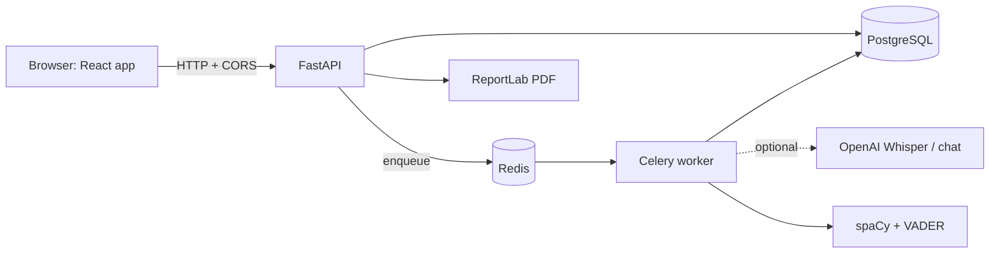

# HireIQ — final project report (Day 10)

Project: **HireIQ — Multimodal AI Interview Intelligence Platform** (CODE-A-NOVA Month 2 internship project).
Deployment status: **Deployment-ready, but external deployment blocked** (no live URL exists; nothing has been deployed).

> Reading guide. Throughout this report "**executed**" means a command was actually run in the available sandbox and its result observed. "**Written**" or "**static**" means code or configuration was inspected or authored but not run. "**Blocked**" means it could not run here; it is never counted as passed or failed. The sandbox had no Docker daemon, no network, no SQLAlchemy/FastAPI/Celery/Alembic/redis/psycopg/OpenAI/spaCy/VADER packages, no `node_modules`, and no running PostgreSQL or Redis.

## 1. Project overview
HireIQ lets a candidate answer interview questions by voice in the browser. The audio is processed in the background, transcribed (OpenAI Whisper API, a local Whisper option, or a mock), evaluated against a YAML rubric by a language model (or a mock), enriched with advisory NLP signals, stored in PostgreSQL, and presented to a hiring manager in a token-protected dashboard with a downloadable PDF report. It supports a human reviewer; it never makes a hiring decision.

## 2. Problem statement
First-round interviews are slow, inconsistent between interviewers, and hard to compare or audit. HireIQ explores a structured alternative: identical questions, a written rubric with weights, per-criterion scores with verbatim quoted evidence, and one review screen, while keeping a person responsible for the decision and being explicit about the risks of automated assessment.

## 3. Objectives
1. Record and upload voice answers from the browser.
2. Transcribe asynchronously without blocking the API.
3. Score answers against a configurable rubric with validated, explainable output.
4. Add advisory NLP signals (keywords, entities, sentiment, confidence indicator).
5. Produce a PDF report and a hiring-manager dashboard.
6. Allow rubric and question-bank configuration.
7. Test, review security and bias, document, and package for deployment.

## 4. Features implemented (status = what was verified)
| Feature | Implemented in code | Verified by execution here |
|---|---|---|
| Candidate UI, consent, per-question timer, browser recording, preview, one submission per question | yes | not in a real browser with a microphone; component tests (vitest) **blocked** |
| Audio intake, validation, PyDub decoding, temporary storage | yes | audio-processing API tests **blocked** (need SQLAlchemy/FastAPI); pure helpers covered by offline tests |
| Async transcription (mock / OpenAI Whisper / local Whisper) with retry | yes | mock-style logic via offline tests; Celery tasks and real Whisper/OpenAI **not run** |
| YAML rubric, strict JSON validation, verbatim-evidence check, platform-computed weighted score | yes | offline unit tests **passed**; real model **not called** |
| NLP: spaCy keywords/entities, VADER sentiment, confidence heuristic | yes | logic tested with fakes; real spaCy/VADER **not installed here** |
| PDF report (ReportLab) | yes | rendering and text extraction tested offline (**passed**, on newer reportlab than pinned) |
| Dashboard with token gate, summary, search, filters, paging, session detail, PDF download | yes | API tests **blocked**; UI smoke test against a **mock API** executed earlier (24 checks ok); see section 8 |
| Rubric catalog and question-bank API (token protected) | yes | schema/catalog tests **passed**; API tests **blocked** |
| Docker Compose stack (postgres, redis, backend, worker, frontend) | yes | `docker compose config` **executed (valid)**; images and containers **never built or started** |
| Alembic migrations 0001–0004 | yes | chain checked statically (single head); **never executed** against a database |

## 5. Technology stack
React 18, TypeScript, Vite, vitest · Python 3.12, FastAPI, Pydantic v2, SQLAlchemy 2, Alembic · PostgreSQL 16 · Celery + Redis 7 · OpenAI Whisper (API or local) and OpenAI chat models for evaluation (both optional; mock providers by default) · spaCy and VADER · PyDub + ffmpeg · ReportLab · Docker, Docker Compose, nginx (unprivileged). **Gemini:** only an unused, reserved configuration field exists; there is **no Gemini provider**. **WeasyPrint** is not used; PDFs use ReportLab.

## 6. System architecture
Full diagrams (flowchart, sequence, ER, deployment topology) are in `docs/ARCHITECTURE.md`. In short: the browser calls the FastAPI service directly at `VITE_API_BASE_URL` (a build-time value baked into the static bundle; nginx serves static files only and does **not** proxy `/api`), so the API's `CORS_ORIGINS` must contain the frontend's origin. FastAPI validates input, writes to PostgreSQL and enqueues Celery tasks through Redis; the worker transcribes, then evaluates, then stores the result; managers read it through token-protected routes.



## 7. Implementation summary, Days 1–10
| Day | Delivered | Status of evidence |
|---|---|---|
| 1 | Backend foundation: FastAPI app, settings with production safeguards, SQLAlchemy models, Alembic 0001, Celery/Redis wiring, health endpoints, Docker/Compose, CI | written; offline tests executed |
| 2 | React interview UI, consent, timer, browser audio recording, API client | UI tests written; not re-run in Day 10 (vitest blocked) |
| 3 | Audio intake and PyDub processing, async Whisper transcription (mock/OpenAI/local), retry, migration 0002 | partly executed offline |
| 4 | YAML rubric, response schema, prompt builder, OpenAI/mock evaluation provider, strict validation, evaluation task, migration 0003 | offline tests executed |
| 5 | NLP enrichment: keywords, entities, VADER sentiment, confidence heuristic (advisory) | tested with fakes |
| 6 | PDF evaluation report and token-protected endpoint | rendering tested offline |
| 7 | Hiring-manager dashboard API and UI, shared-token gate (in memory only), filters, paging, PDF download | UI smoke test against a mock API |
| 8 | Rubric catalog, question-bank API with validation, migration 0004, seed data; wildcard-filter fix after review | offline tests executed; API tests blocked |
| 9 | End-to-end simulation tests, bias and fairness review and tests, security review and tests | 92 new tests executed and passed |
| 10 | Frontend Dockerfile and nginx config, compose frontend service, env template additions, CI smoke check, README rewrite, deployment/user/architecture/demo docs, this report, final packaging | configuration validated statically; see sections 8–9 |

**Day 10 changes to the baseline (no application source, tests or migrations were touched):** added `frontend/Dockerfile`, `frontend/nginx.conf`, `frontend/.dockerignore`, `docs/DEPLOYMENT_GUIDE.md`, `docs/USER_GUIDE.md`, `docs/DEMO_SCRIPT.md`, `docs/FINAL_PROJECT_REPORT.md`; modified `README.md`, `docs/ARCHITECTURE.md`, `docs/PROGRESS.md`, `docker-compose.yml` (frontend service, extra pass-through variables, CORS default adds `http://localhost:3000`), `.env.example` (frontend variables), `.github/workflows/ci.yml` (one extra smoke check). Removed: nothing.

## 8. Testing results
Environment: Linux, Python 3.13 (the project targets 3.12), pytest 9.1.1, Node 22, no Docker daemon, no network. Settings tests use a **stand-in for `pydantic_settings` kept outside the repository** because the real package is not installed; `--noconftest` was needed because `conftest.py` imports SQLAlchemy. Sandbox pydantic and reportlab are newer than the pinned versions.

Command (one run, junit XML used for the numbers):
```
cd backend && export ENVIRONMENT=test DATABASE_URL=sqlite:// SECRET_KEY=test-only-secret-key-0123456789abcdef REDIS_URL=redis://localhost:6379/0 PYTHONPATH=<stand-in>:.
python3 -B -m pytest --noconftest -W error -p no:cacheprovider -q --continue-on-collection-errors tests --junitxml=...
```

### 8.1 Backend (Python)
| Category | Count | Notes |
|---|---|---|
| Tests collected | **749** | 18 files could not be collected |
| Tests executed | **748** | passed + failed |
| Tests passed | **748** | identical to the Day 9 result; nothing changed |
| Tests failed | **0** | |
| Tests skipped | **2** | `test_nlp_real_libs.py` (spaCy not installed), `test_openai_real.py` (needs `RUN_REAL_WHISPER=1` and an API key) |
| Tests blocked | **18 files** (about 246 test functions, a lower bound) | fail at import: `ModuleNotFoundError` for SQLAlchemy/FastAPI/Celery etc. Files: test_api, test_audio_intake, test_audio_processing, test_celery_app, test_dashboard_api, test_database_config, test_day9_workflow_e2e, test_evaluation_engine, test_integration_services, test_interview_api, test_migrations, test_models, test_question_bank_api, test_report_api, test_seed_demo, test_transcription_api, test_transcription_service, test_transcription_tasks |
| Tests not executed | the same blocked set, plus all real-service integration tests | |

Day 9 modules re-run individually in Day 10: `test_day9_e2e_chain` 17 passed, `test_day9_bias_fairness` 39 passed, `test_day9_security` 36 passed, `test_repo_files` 8 passed (rerun after the Day 10 compose and `.env.example` edits). The blocked `test_day9_workflow_e2e` (6 tests) has never run.

**What these passes are not:** they are offline unit tests, static/AST inspections and an in-process simulation with fake providers. They are **not** real backend integration tests: no HTTP request reached FastAPI, no query reached PostgreSQL, no task ran through Redis/Celery, and no Whisper/OpenAI call was made. A group of 17 "end-to-end" tests exercises the component chain in-process with mock providers.

### 8.2 Mock-API tests versus real-backend integration tests
| Kind | What ran | Result |
|---|---|---|
| Mock API (Day 7 UI smoke test, executed earlier in this Day 10 session) | a prebuilt dashboard bundle served by `python3 -m http.server`, talking to a **mock API** written for the test; the script lives outside the repository | 24 checks ok, 0 failed. It shows the token gate, listing, filters and detail rendering against **assumed** API shapes; it is **not** evidence that the real backend returns those shapes |
| Real-backend integration (`tests/test_integration_services.py`, `RUN_INTEGRATION=1`) | not run | **blocked**: needs PostgreSQL, Redis and the Python clients |
| Real-backend HTTP tests (TestClient: interview, dashboard, report, question bank, transcription APIs) | not run | **blocked** |

### 8.3 Frontend
| Check | Result |
|---|---|
| `npm run typecheck` | **blocked**. Exact error: `error TS2688: Cannot find type definition file for 'vite/client'.` (`node_modules` absent) |
| `npm run build` (typecheck + `vite build`) | **blocked** (its first step is the typecheck); no production build was produced here |
| `npm test` (vitest) | **blocked**: dependencies not installed |
| `npm install` | **blocked**: `npm ping` fails, no network; not retried |
| Dashboard route and token flow | statically inspected in source (hash route `#/dashboard`; token in component memory, never in storage or URL; 401 and 503 messages); runtime behaviour seen only in the mock-API smoke test above |
| API configuration | `VITE_API_BASE_URL` (default `http://localhost:8000`) is read in `src/services/config.ts`; no proxy exists, so CORS must allow the frontend origin |

### 8.4 Infrastructure
| Check | Result |
|---|---|
| `docker compose config -q` using a copy of `.env.example` with a password and secret filled in | **executed, valid**; services listed: postgres, redis, backend, frontend, worker |
| Docker daemon | **unavailable**: `failed to connect to the docker API at unix:///var/run/docker.sock` |
| `docker build` / `docker compose up` | **not executed (blocked)**. No image was built, no container started, no health check ran |
| Backend `Dockerfile` (repo root, context `.`), `frontend/Dockerfile`, `frontend/nginx.conf` | **statically inspected only**: paths referenced by `COPY` exist; nginx.conf braces balance; `nginx -t` was **not run** (nginx not installed); `hadolint` not available |
| Environment-variable consistency | scripted check: every variable compose passes is a `Settings` field; the Settings fields not forwarded all have defaults (static) |
| Migration order | static: single chain 0001 → 0002 → 0003 → 0004, one head; migrations **never executed** and are unchanged from Day 9 |
| Health checks | defined for postgres (`pg_isready`), redis (`redis-cli ping`), backend (`/health`), frontend (`wget` on port 8080); the worker has none. **None executed** |

## 9. Deployment status
**Deployment-ready, but external deployment blocked.** No provider credentials, hosting account, Docker daemon or network were available, and the repository contains no provider-specific configuration (no Render, Fly, Railway, Kubernetes or similar). Therefore: no URL exists, nothing is live, and nothing was verified remotely. Reproducible local instructions are in `README.md` and `docs/DEPLOYMENT_GUIDE.md`. Remaining manual steps: (1) on a machine with Docker, `cp .env.example .env`, generate and set secrets, `docker compose up --build -d`, and observe health checks and `alembic upgrade head`; (2) run the blocked backend tests with the pinned dependencies; (3) `npm install && npm run typecheck && npm test && npm run build` in `frontend/` and commit a lockfile; (4) choose a host, terminate TLS, set `ENVIRONMENT=production` with strong secrets, explicit `CORS_ORIGINS` and a real `VITE_API_BASE_URL`; (5) verify the real providers with a rehearsal.

## 10. Security considerations
Details: `docs/DAY9_TESTING_REPORT.md` (SEC-1 to SEC-9) and `docs/DEPLOYMENT_GUIDE.md`.
- **Manager access is one shared bearer token** (`REPORT_ACCESS_TOKEN`, minimum 16 characters, constant-time comparison, disabled with 503 when unset). It is **not** individual user authentication: there are no accounts, roles or audit trail, and no rate limiting exists in the backend.
- The candidate API has no authentication; the session UUID acts as a capability.
- `ENVIRONMENT=production` rejects a short or `change-me` `SECRET_KEY` and the mock providers, but still accepts `CORS_ORIGINS=*` (credentials are then disabled).
- Errors: unhandled exceptions return a generic 500 and log only the exception type; validation errors use the framework default and can echo submitted values.
- API docs (`/docs`) are exposed in every environment. The frontend nginx sends `nosniff`, frame denial, no-referrer and a permissions policy, but no CSP or HSTS; the API sends no security headers.
- Personal data (name, e-mail, transcripts) is stored in plain text with no retention or deletion workflow; with OpenAI providers, audio and transcripts are sent to a third party.
- No `.env`, key or token is in the repository or archive (the final archive is scanned for `.env` files and key patterns before delivery; the result is reported in the Day 10 completion message). Dependencies were not vulnerability-scanned.
- Day 10 did not weaken any of these controls.

## 11. Bias and fairness considerations
Details: `docs/BIAS_AND_FAIRNESS_REVIEW.md`. Safeguards: the rubric names only job-related criteria, the platform computes the weighted score, quotes must appear verbatim, NLP signals cannot change scores, no demographic fields are collected, and output is labelled advisory. Documented weaknesses (found by review and tests, not fixed): the recommendation is not reconciled with the score; evidence quotes can be weak support; missing information lowers a score; ASR quality is not flagged and may disadvantage accents or noisy audio; filler words, hedging and keyword lists influence the heuristic confidence indicator; person and place entities are displayed; rubric wording contains style assumptions; run-to-run model variance is not measured. **No validation with real candidates, real Whisper or a real model was performed**, so no fairness claim is made. A human must decide.

## 12. Known limitations
1. The whole container stack, all Docker images, the migrations on a real database, Celery/Redis processing and the real OpenAI/Whisper/spaCy/VADER paths have **never been executed** by the author.
2. About 246 backend test functions (18 files) are blocked in this environment, and the 6 database-backed Day 9 workflow tests have never run. The frontend typecheck, build and vitest suite are blocked here.
3. Not deployed; no URL; no provider-specific deployment files.
4. Shared-token manager access, no rate limiting, no per-user accounts or audit log, no data retention/deletion workflow.
5. No Gemini provider (reserved setting only); WeasyPrint not used.
6. No frontend lockfile (the Docker build runs `npm install`, so builds are not reproducible); the spaCy model is downloaded from GitHub at image build time.
7. The worker has no health check; `/docs` is exposed in every environment; `CORS_ORIGINS=*` is accepted in production.
8. No UI for question bank or rubric management (API and YAML only); no upload of pre-recorded audio.
9. Test runs used newer pydantic/reportlab than pinned, Python 3.13 instead of 3.12, and a settings stand-in.
10. Bias and security findings from Day 9 remain open (section 11 and 10).

## 13. Future scope
Run and fix everything that was blocked (full CI with pinned dependencies, real PostgreSQL/Redis, migration upgrade and downgrade on a copy); commit a frontend lockfile and add `nginx -t` and image builds to CI; per-user authentication with roles, audit log and rate limiting; a security-header proxy and refusal of wildcard CORS in production; reconcile recommendations with scores; flag low-quality transcripts; independent rubric reviews and a bias evaluation with real data and several models; measure run-to-run variance; retention and deletion tools; a Gemini provider if wanted; question-bank and rubric screens; a worker health check; provider-specific deployment manifests once an account exists.

## 14. Conclusion
HireIQ delivers a complete, documented, configurable pipeline from voice answer to reviewer report, with strict validation, advisory-only AI output, and an honest list of risks. It is suitable for a demonstration with mock providers and for a local Docker Compose trial. It has **not** been deployed, its container and database paths have not been run, and it is **not** ready for production use with real candidates until the items in sections 12 and 13 are completed and the real services are verified.
